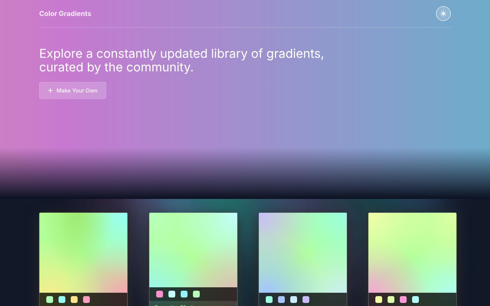
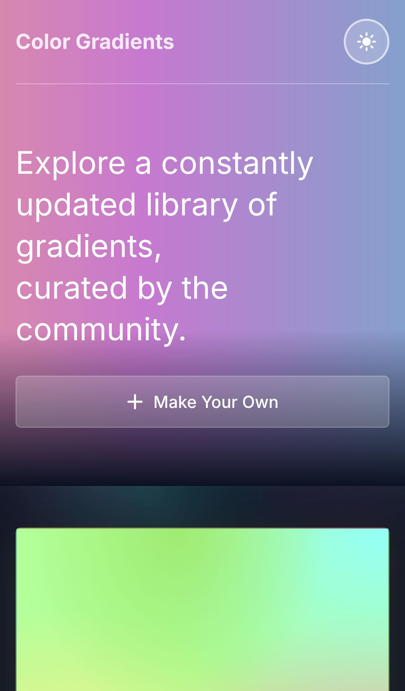
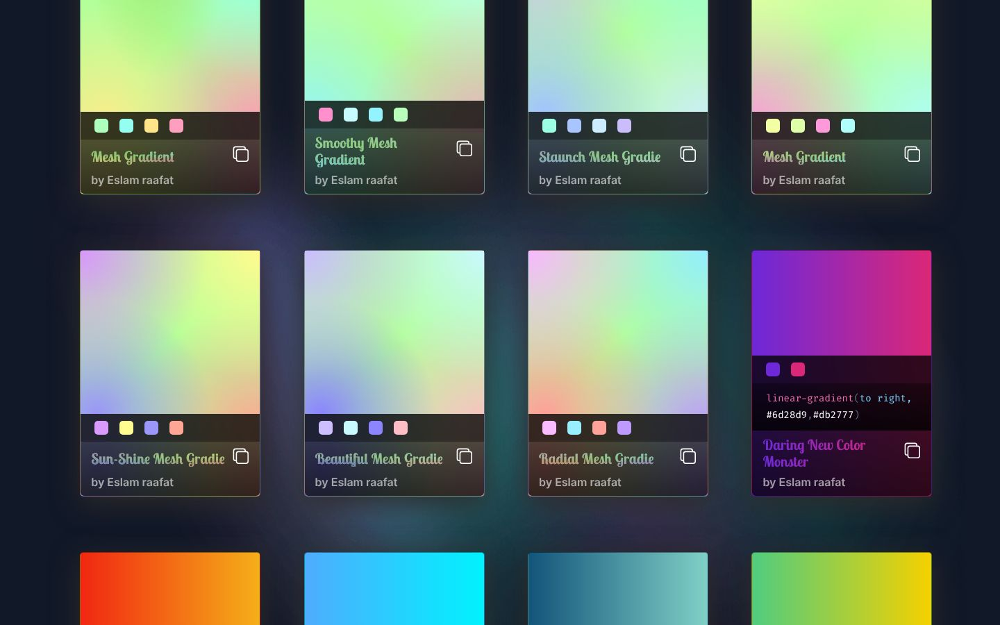
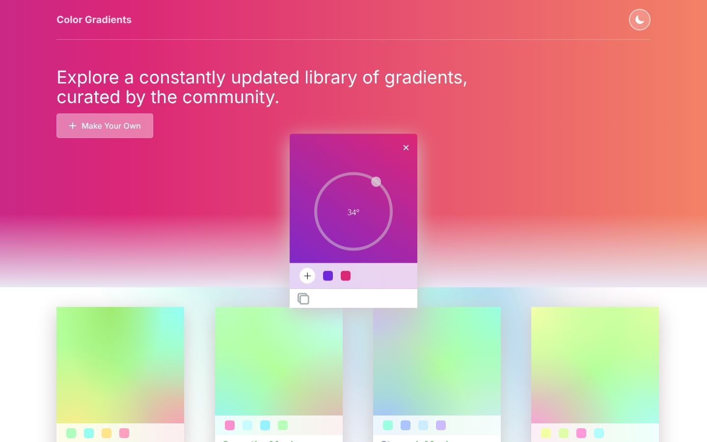

<div align="center">

# Color Gradients

### CSS gradient library and gradient maker · HTML · CSS · Vanilla JavaScript

Browse a collection of linear and mesh CSS gradients, copy any of them as ready-to-paste CSS with one click, or build your own gradient with colour pickers and a circular angle slider. Includes a dark and a light theme.

[](https://developer.mozilla.org/docs/Web/HTML)
[](https://developer.mozilla.org/docs/Web/CSS)
[](https://developer.mozilla.org/docs/Web/JavaScript)
[](https://jquery.com)
[](https://clipboardjs.com)
[](https://ionic.io/ionicons)
<br>
[](https://eslamraafat1.github.io/Color-App/)

**[Live demo](https://eslamraafat1.github.io/Color-App/)** ·
**[Portfolio](https://new-portfolio-ashy-xi.vercel.app/)** ·
**[LinkedIn](https://www.linkedin.com/in/eslamraafat-dev/)** ·
**[Email](mailto:eslamraafat736@gmail.com)**

<br>



</div>

<table>
  <tr>
    <td width="33%"></td>
    <td width="67%">
      <br><br>
      
    </td>
  </tr>
  <tr>
    <td align="center"><sub>Mobile (iPhone 13)</sub></td>
    <td align="center"><sub>Gradient cards (dark theme) · "Make Your Own" gradient maker</sub></td>
  </tr>
</table>

---

## Overview

**Color Gradients** is a small front-end tool for designers and developers who need a CSS background quickly. It is a personal practice project (2023) that I adapted from the open-source [gradient_container](https://github.com/shyamtala003/gradient_container) project by Shyam Tala, whose original links are still commented out in `index.html`.

What I practised:

- Generating UI from JavaScript data (arrays of gradient objects rendered into cards with `document.createElement`).
- Working with CSS `linear-gradient` and layered `radial-gradient` ("mesh") backgrounds.
- Theme switching by swapping stylesheets, and integrating third-party widgets (clipboard.js, a jQuery circular range slider, Ionicons).

## Features

### Gradient library

- **66 gradients** defined in `constants/`: 7 mesh gradients (layered `radial-gradient`s over a base colour) and 59 two-colour linear gradients.
- Each card shows the gradient, its colour swatches, a name written in the gradient itself (`background-clip: text`) and the author line.
- Linear gradient cards also show their CSS code with syntax-style colouring.

### One-click copy

- Every card has a copy button that puts ready-to-paste CSS on the clipboard (for example `background:linear-gradient(to right, #6d28d9, #db2777);`). Mesh gradients copy both the `background` colour and the `background-image` layers.
- A "color copied!" toast confirms the copy.

### Make your own

- **Make Your Own** opens a gradient maker with a **circular angle slider** (0–360°) and colour pickers.
- Start with two colours and add up to five; the preview and the CSS to copy update live.

### Themes and layout

- **Dark / light theme** toggle (sun / moon icon) that swaps `css/dark.css` and `css/white.css`.
- Responsive card grid that drops to one column on phones.
- Footer with a newsletter field (front-end only, not connected to a service) and social links.

## Tech stack

| Layer | Tools |
| --- | --- |
| Markup and styles | HTML5, CSS3 (two theme stylesheets), Google Fonts (Lobster Two, Fira Code) |
| Scripting | Vanilla JavaScript (DOM generation, event handling) |
| Libraries | clipboard.js, jQuery 3.6.1 (CDN) + `lcnCircleRangeSelect` circular slider, Ionicons 5.5.2 (CDN) |
| Hosting | GitHub Pages |

## Project structure

```text
.
├── index.html                    # layout: gradient maker, hero, card container, footer
├── main.js                       # theme toggle, clipboard + toast, gradient maker logic
├── constants/
│   ├── meshGradientCard.js       # mesh gradient data + card rendering
│   └── gradientCard.js           # linear gradient data + card rendering
├── css/
│   ├── dark.css                  # dark theme (default)
│   └── white.css                 # light theme
├── dist/                         # clipboard.js and the circular range slider plugin
├── images/                       # background images
├── favicons/                     # favicon and touch icons
└── docs/screenshots/             # README images
```

## Getting started

No build step and no dependencies to install:

```bash
git clone https://github.com/Eslamraafat1/Color-App.git
cd Color-App
npx serve .        # or simply open index.html in a browser
```

## Deployment

Deployed with **GitHub Pages** from the `master` branch: [eslamraafat1.github.io/Color-App](https://eslamraafat1.github.io/Color-App/).

## Author

**Eslam Raafat** — Front-End Developer (React · Next.js · TypeScript)

- **Portfolio:** [new-portfolio-ashy-xi.vercel.app](https://new-portfolio-ashy-xi.vercel.app/)
- **LinkedIn:** [linkedin.com/in/eslamraafat-dev](https://www.linkedin.com/in/eslamraafat-dev/)
- **GitHub:** [@Eslamraafat1](https://github.com/Eslamraafat1)
- **Email:** [eslamraafat736@gmail.com](mailto:eslamraafat736@gmail.com)

<sub>Based on [gradient_container](https://github.com/shyamtala003/gradient_container) by Shyam Tala.</sub>
